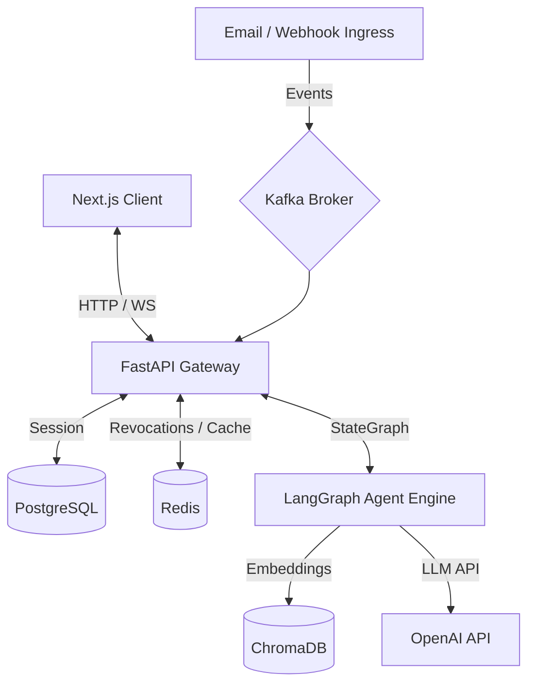

# System Architecture: AegisAI

This document outlines the technical architecture, data pipelines, and tool communication mapping.

## Tech Stack Overview

* **Frontend**: Next.js (App Router, TypeScript, React 19)
* **Backend**: FastAPI (Python 3.11, async-first engine)
* **Agent Engine**: LangGraph + LangChain
* **Database & ORM**: PostgreSQL + SQLAlchemy 2.0 (Async) + Alembic
* **Vector Store**: ChromaDB (extendable to Pinecone)
* **Caching & Queue**: Redis (JWT blacklist, rate limiter)
* **Streaming**: Kafka (event integration)
* **Deployment**: Docker & Docker Compose

## Component Diagram

## Data Models
1. **Users**: Credentials and roles.
2. **Audit Logs**: Traceability tracking.
3. **Contacts**: Customer metadata.
4. **Threads & Messages**: Conversation records.
5. **Actions**: Actions executed by agents (email, database query, ticket creation).
6. **Documents & Knowledge Chunks**: Ingestion layer storage.
